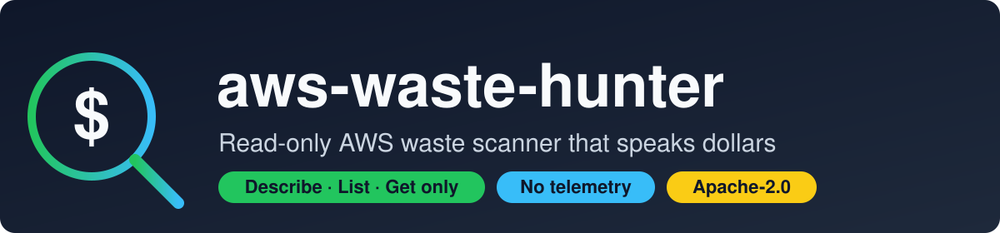
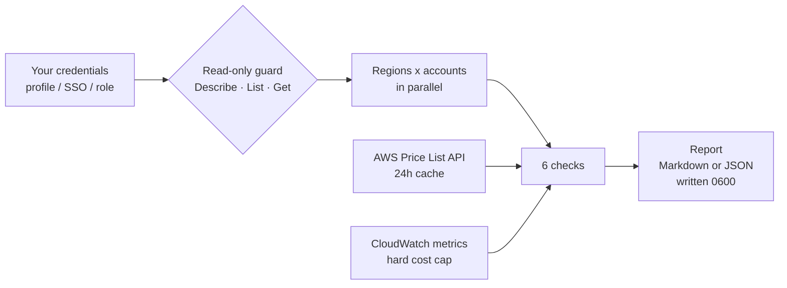

<div align="center">



[](https://github.com/Priteshkal/aws-waste-hunter/actions/workflows/ci.yml)
[](https://pypi.org/project/aws-waste-hunter/)
[](https://pypi.org/project/aws-waste-hunter/)
[](LICENSE)
[](https://github.com/Priteshkal/aws-waste-hunter/releases)


**[Quick start](#quick-start)** ·
**[Checks](#checks)** ·
**[Security model](#security-model)** ·
**[Docs](#documentation)** ·
**[Roadmap](#roadmap)** ·
**[Helyx IT](https://helyxit.com)**

</div>

---

`aws-waste-hunter` scans your AWS accounts for resources that cost money and do nothing, and
tells you **how many dollars** you can save. It runs on your machine, can only read, and you
can audit all of it in an afternoon.

## Why this one

| | |
|---|---|
| 🔒 **It cannot change your account** | Every AWS call is `Describe*`, `List*` or `Get*`, enforced in code, in tests and in the IAM policy you attach |
| 🏠 **It stays on your machine** | No SaaS, no agent, no telemetry. A test fails if the source imports a network module |
| 📖 **You can read all of it** | Small codebase, one runtime dependency (`boto3`), published least-privilege IAM policy |
| 💵 **It speaks dollars** | Each finding has a monthly cost and a savings estimate from the live AWS Price List API |
| 🌍 **It scales out safely** | All regions and many accounts in parallel, with a hard cap on CloudWatch spend |

## Quick start

```bash
pipx install aws-waste-hunter

aws-waste-hunter scan --region us-east-1 --profile my-sso-profile
```

Other ways to run it:

<details>
<summary>Docker</summary>

```bash
docker build -t aws-waste-hunter .
docker run --rm -v ~/.aws:/home/scanner/.aws:ro \
  aws-waste-hunter scan --region us-east-1 --profile my-sso-profile
```
</details>

<details>
<summary>From source, with hash-pinned dependencies</summary>

```bash
git clone https://github.com/Priteshkal/aws-waste-hunter && cd aws-waste-hunter
pip install --require-hashes --no-deps -r requirements.lock
pip install --no-deps .
```
</details>

Create a scanning role with only the permissions it needs:
[`iam/policy.json`](iam/policy.json) is the whole list (20 read-only actions, no wildcards).

## What you get

```text
$ aws-waste-hunter scan --all-regions --format md
```

| Account | Region | Check | Resource | Reason | Cost/mo | Savings/mo | Confidence |
|---|---|---|---|---|---:|---:|---|
| 111122223333 | us-east-1 | ebs-unattached | `vol-0123…` | 500 GiB gp3 volume is not attached | $40.00 | $40.00 | high |
| 111122223333 | us-east-1 | nat-idle | `nat-0a1b…` | NAT gateway moved 0 bytes in 7 days | $32.85 | $32.85 | medium |
| 111122223333 | us-east-1 | ebs-gp2-to-gp3 | `vol-0fed…` | 1000 GiB gp2 volume could be gp3 | $100.00 | $20.00 | high |
| 111122223333 | eu-west-1 | lb-idle | `staging-api-alb` | ALB received no traffic in 7 days | $16.43 | $16.43 | medium |

**Estimated monthly savings: $112.93.** Full example: [sample report](docs/sample-report.md)
(fictional data).

## How it works



1. **Credentials** come from the standard AWS chain, or an assumed read-only role per account.
2. **The guard** sits in front of every AWS call and refuses anything that is not a read.
3. **Checks** run per account and region in parallel; a failing check is reported, never hidden.
4. **Pricing** is looked up per region and sanity-checked against an offline reference.
5. **The report** is written locally with private permissions.

## Checks

| Check | Finds | Confidence |
|---|---|---|
| `ebs-unattached` | EBS volumes not attached to anything | high |
| `ebs-gp2-to-gp3` | In-use gp2 volumes that could be gp3 (about 20% cheaper) | medium |
| `eip-unassociated` | Elastic IPs allocated but not associated | high |
| `logs-no-retention` | CloudWatch log groups that never expire | low (no savings figure) |
| `nat-idle` | NAT gateways that moved 0 bytes in 7 days | medium |
| `lb-idle` | ALBs and NLBs with no traffic in 7 days | medium |

Details, IAM actions and caveats for each check: **[docs/checks.md](docs/checks.md)**.

A check that fails (for example a missing permission) is listed in the report and the exit
code is `1`. It is never silently skipped.

## Multiple regions and accounts

```bash
aws-waste-hunter scan --all-regions                         # every enabled region, in parallel
aws-waste-hunter scan --regions us-east-1,eu-west-1 --format json --output report.json

# Other accounts: assume a read-only role in each
aws-waste-hunter scan --all-regions \
  --role-arn arn:aws:iam::222222222222:role/aws-waste-hunter-scanner \
  --external-id "$WASTE_HUNTER_EXTERNAL_ID"
```

A Terraform module creates the cross-account role with an ExternalId requirement. Setup,
sequence diagram and safety notes: **[docs/cross-account.md](docs/cross-account.md)**. All
options and exit codes: **[docs/cli.md](docs/cli.md)**.

## Pricing

Prices come from the AWS Price List API per region, are cached for 24 hours, and fall back to
an offline us-east-1 list-price table if the lookup fails. Every report states which source
was used. Live and cached values must be positive and within 0.25x-4x of the reference, so a
bad parse or a tampered cache cannot inflate your numbers. NAT gateway and load balancer
figures use us-east-1 list prices. Amounts are estimates, not quotes.

## Security model

| Risk | How it is handled |
|---|---|
| The tool modifies your account | Guard allows only `Describe`, `List`, `Get` and exact `AssumeRole`; a CI test fails on any mutating call; the IAM policy has no write actions; proven against a real policy-only role |
| A check needs a permission not in the policy | A test fails if any check's required actions are missing from `iam/policy.json` |
| Data leaves your machine | No telemetry; a test fails if the source imports a network or subprocess module; credentials are never stored, logged or sent |
| Confused deputy on cross-account roles | ExternalId required; credentials last 1 hour and stay in memory |
| Malicious resource names in reports | Names and tags are escaped when rendering |
| Poisoned prices | Sanity band and a private (`0600`) cache; the source is printed in every report |
| The scan itself costs money | Metric queries are charged to a hard budget before each call |
| Supply chain | One runtime dependency, hash-pinned lockfile, `pip-audit`, gitleaks, Actions pinned to commit SHAs, Dependabot, PyPI trusted publishing |

Read the full **[threat model](THREAT_MODEL.md)**. To report a vulnerability, see
**[SECURITY.md](SECURITY.md)**.

## Documentation

| Page | Contents |
|---|---|
| [docs/checks.md](docs/checks.md) | Every check: logic, savings, confidence, IAM actions, caveats |
| [docs/cli.md](docs/cli.md) | All options, exit codes, examples |
| [docs/cross-account.md](docs/cross-account.md) | Scanning many accounts with assumed roles |
| [docs/sample-report.md](docs/sample-report.md) | What a report looks like |
| [THREAT_MODEL.md](THREAT_MODEL.md) | Assets, threats and controls |
| [terraform/scanner-role](terraform/scanner-role) | Terraform module for the scanning role |

## Roadmap

| Status | Item |
|---|---|
| ✅ Available | Six checks, live pricing, all regions in parallel, cross-account roles, Terraform role module, Docker image, PyPI releases |
| 🚧 Next | `--redact` for shareable reports; Organizations account discovery; more checks (idle EC2 and RDS, old snapshots, S3 lifecycle) |
| 🗓 Planned | GitHub Action and GitLab component; signed container images; optional AI summary (never detects, never acts) |

## Pro (planned)

The open-source scanner finds the mechanical waste. **Pro** is where it becomes a savings
program. These features are on the roadmap and are **not available yet**.

<details>
<summary>See the planned Pro features</summary>

**Find more, across everything**
- **Org-wide scans.** Cross-account scanning works today with `--role-arn`; Pro adds automatic
  discovery of every account in your AWS Organization.
- **More metric-based idle detection.** Idle EC2 and RDS, the waste that metadata alone can't
  show, still under a hard cost cap.
- **EKS right-sizing.** Requests versus real usage from Datadog or Prometheus, plus the
  autoscaler blockers that keep nodes alive. The same playbook behind a 70%+ node reduction.
- **Commitment review.** Savings Plans and Reserved Instance coverage, usually the biggest lever.

**Fix it safely**
- **Fix-as-code merge requests.** Generates the Terraform or CLI change as a GitLab or GitHub
  MR for a human to review. It never applies anything itself.
- **Terraform cost guard.** Estimates the monthly cost of every `terraform plan` and flags
  expensive patterns before they merge.
- **Suppressions with expiry.** Accept a finding per resource or tag, with an owner and a
  review date, kept as policy-as-code in your repo.

**Prove the savings**
- **Trend history and scheduled scans.** Weekly digests to Slack or email and a running total
  of dollars saved.
- **AI prioritization in your own account.** Ranks findings by effort versus payoff using
  Bedrock or a local model. The AI only summarizes: it never detects and never acts.
- **Export anywhere.** SARIF, CSV and Jira.
</details>

### Don't want to run it yourself?
[Helyx IT](https://helyxit.com) does manual, expert-led AWS reviews with a **guaranteed 15%
savings**, and goes where automation can't: architecture, data-transfer design and commitment
strategy. [Book a call](https://helyxit.com).

## FAQ

<details>
<summary>Can it delete or change anything?</summary>

No. The guard refuses every operation except `Describe`, `List`, `Get` and the exact
`sts:AssumeRole`, and the IAM policy you attach has no write actions. Tests enforce both.
</details>

<details>
<summary>Does any data leave my machine?</summary>

The scanner only talks to AWS endpoints. There is no telemetry, and reports are written to
local files with `0600` permissions. Nothing is uploaded anywhere.
</details>

<details>
<summary>What does a scan cost?</summary>

EC2, ELB, Logs and Price List calls are free. The metric-based checks use CloudWatch
`GetMetricData`, about $0.01 per 1,000 metrics; the default cap of 200 per account and region
is about $0.002. Lower it with `--max-metrics`.
</details>

<details>
<summary>How accurate are the savings?</summary>

They are estimates from list prices. They cannot see your discounts, Savings Plans or
Reserved Instances. Confidence is shown per finding, and a human should confirm before
deleting anything.
</details>

<details>
<summary>Why was a new load balancer or NAT gateway not flagged?</summary>

Metric checks only judge resources older than 7 days, because younger ones have no history.
</details>

## Develop

```bash
python3.13 -m venv ~/.venvs/aws-waste-hunter && source ~/.venvs/aws-waste-hunter/bin/activate
pip install -e ".[dev]"
ruff check . && mypy src && pytest
```

Tests use [moto](https://github.com/getmoto/moto) and canned Price List responses; no AWS
account or credentials are needed. Every change goes through a pull request with CI (tests on
Python 3.10, 3.12 and 3.13, ruff, mypy strict, pip-audit, gitleaks, a Docker build).

## License

[Apache-2.0](LICENSE) · Built by [Helyx IT](https://helyxit.com)
