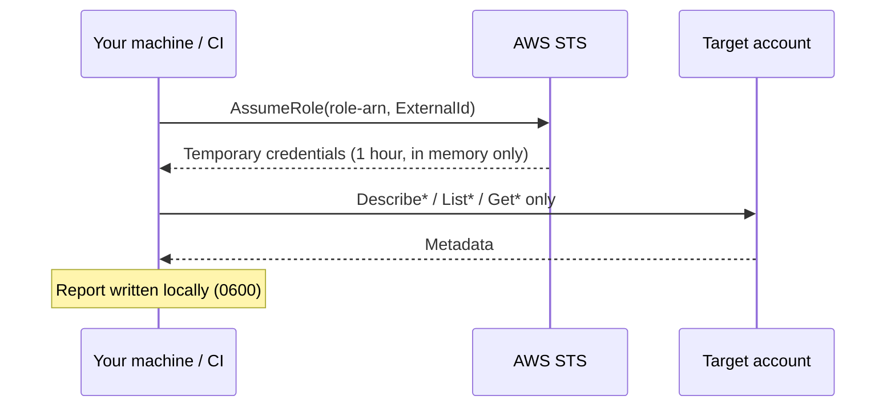

# Scanning other accounts

The scanner assumes a read-only role in each target account with short-lived credentials.



## 1. Create the role
Use the Terraform module in [`terraform/scanner-role`](../terraform/scanner-role):

```hcl
module "waste_hunter_role" {
  source                 = "github.com/Priteshkal/aws-waste-hunter//terraform/scanner-role"
  trusted_principal_arns = ["arn:aws:iam::111111111111:role/waste-hunter-runner"]
  external_id            = var.waste_hunter_external_id # at least 16 random characters
}
```

The role grants exactly [`iam/policy.json`](../iam/policy.json): Describe, List and Get
actions, no wildcards. Trust is limited to the principals you list and requires the ExternalId.

## 2. Scan
```bash
aws-waste-hunter scan --all-regions \
  --role-arn arn:aws:iam::222222222222:role/aws-waste-hunter-scanner \
  --role-arn arn:aws:iam::333333333333:role/aws-waste-hunter-scanner \
  --external-id "$WASTE_HUNTER_EXTERNAL_ID"
```
The principal running the scan also needs `sts:AssumeRole` on those roles in its own IAM policy.

## Why an ExternalId
It protects against the confused-deputy problem: a role that trusts your account should only be
usable when you present the shared secret. A wrong or missing ExternalId is refused (exit code
`2`).

## Safety notes
- `sts:AssumeRole` is the only non-read operation the guard allows, matched exactly (variants
  such as `AssumeRoleWithWebIdentity` are blocked).
- Assumed credentials are never written to disk or logged.
- Each worker thread uses its own boto3 session; scans run in parallel, bounded by
  `--concurrency`.
